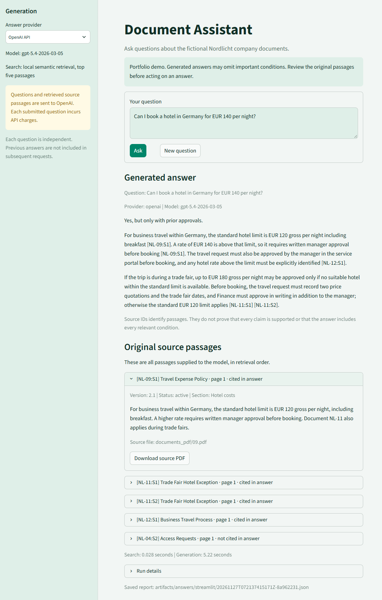
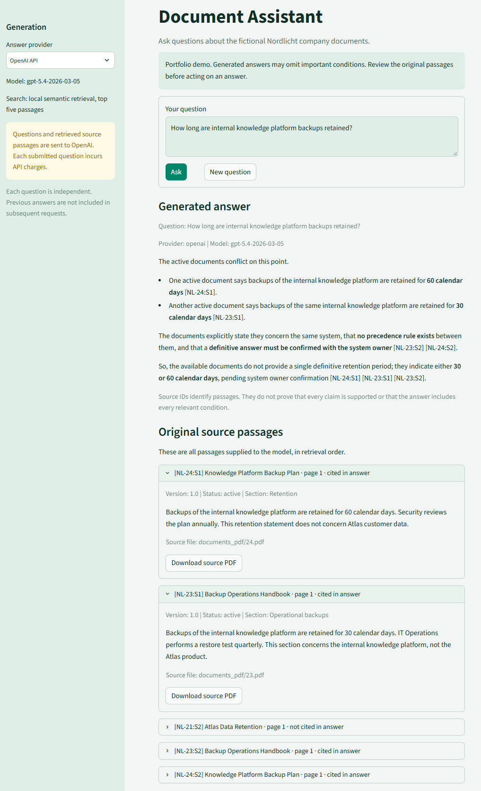
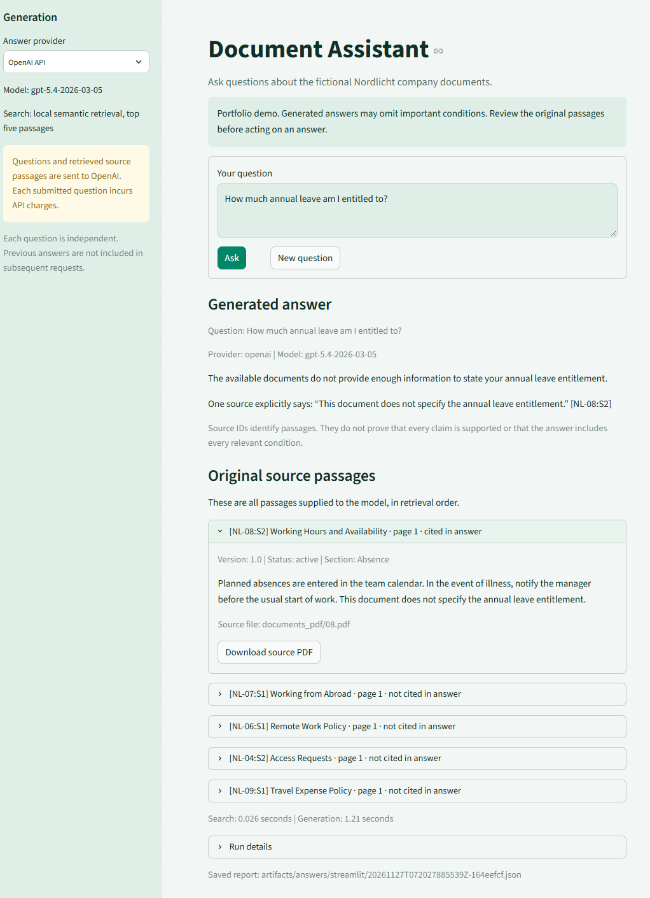

# Document Assistant with Source Citations and Evaluation

[](https://github.com/SL14-SL/rag-document-assistant/actions/workflows/ci.yml)

[](https://docs.astral.sh/ruff/)
[](https://streamlit.io/)
[](https://docs.astral.sh/uv/)

An English-language RAG application for querying text-based PDF documents.
It supports the bundled fictional Nordlicht company corpus and separate
customer document collections, combining local semantic retrieval with
local Ollama generation or an explicitly selected OpenAI API backend.

Answers are displayed alongside the original passages supplied to the
model, including document titles, versions, page references and PDF
downloads.

## Project overview

Download the one-page project summary:

- [English – Case Study (PDF)](docs/rag_document_assistant_case_study_en.pdf)
- [Deutsch – Projektübersicht (PDF)](docs/rag_document_assistant_case_study_de.pdf)

## Application preview

### Answer with source evidence



### Conflicting documents

The assistant identifies contradictory retention periods and refers
the question to the system owner.



### Insufficient information

The assistant states when the supplied documents do not establish
an answer.



## Features

- PDF ingestion with document, section and page metadata.
- Generic PDF import with automatic manifest generation, SHA256 checksums
  and token-aware, overlapping page-level chunks.
- Separate customer corpora, indexes and answer reports.
- BM25 baseline and semantic retrieval.
- A persisted semantic index and an in-memory search model.
- Local generation through Ollama.
- Optional OpenAI generation through the Responses API.
- Original source passages and downloadable source PDFs.
- Saved requests, answers, timings and provider metadata.
- Retrieval evaluation and manual answer-quality review.
- Automated software tests and continuous integration.
- Streamlit interface with a light theme, provider selection and question reset.
- Docker demo deployment with a prebuilt semantic index and a separate
  customer configuration with read-only documents and index.
- Configurable generation provider restrictions and document updates without
  rebuilding the customer application image.
- Automated container build and smoke checks for both deployment modes.

Each question is independent. Previous questions and answers are not
included in subsequent requests.

## Architecture

1. Extract structured sections (demo) or token-aware page-level passages
   (generic PDFs).
2. Build a semantic index of active document sections.
3. Retrieve the five most relevant sections for a question.
4. Send the question and source passages to the selected language model.
5. Check whether detected source IDs belong to the supplied passages.
6. Display the answer and all supplied source passages.

The search model and index remain cached between questions in Streamlit.
Before a new request, the manifest and active PDF checksums are verified;
a changed manifest or index invalidates the relevant cache key.
Generation providers share the same prompt construction and retrieval
pipeline. Provider failures do not trigger an automatic fallback.

## Requirements

- Python 3.12.
- uv.
- Ollama with `qwen2.5:14b` for local generation.
- An OpenAI API key and available API credit for API generation.

The first installation downloads Python packages. Semantic retrieval
also requires an initial download of
`sentence-transformers/all-MiniLM-L6-v2`.

Local generation was tested on an Intel i7-8665U laptop with approximately
32 GB RAM and CPU-only inference. It is functional but slow.

## Installation

From the repository root:

```bash
uv sync --locked --dev
uv run python scripts/validate_dataset.py
```

## Prepare the local index (Nordlicht demo)

Extract PDF sections:

```bash
uv run python -m rag_document_assistant.ingestion
```

Build the semantic index:

```bash
uv run python -m rag_document_assistant.retrieval.build_index
```

The initial build may download the embedding model. After it is cached,
the index can be rebuilt offline:

```bash
HF_HUB_OFFLINE=1 uv run python \
    -m rag_document_assistant.retrieval.build_index \
    --offline
```

The indexed corpus contains 48 sections from 24 active documents.
The archived policy is excluded from the active search index.

## Run the application (Nordlicht demo)

```bash
HF_HUB_OFFLINE=1 uv run streamlit run app.py \
    --server.address 127.0.0.1
```

Open http://localhost:8501.

### Local Ollama

Ensure Ollama is running and install the tested model:

```bash
ollama pull qwen2.5:14b
```

Select **Local Ollama** in the sidebar.

After the initial downloads, retrieval and generation can run locally
without an external model API.

### OpenAI API

Set `OPENAI_API_KEY` in the same terminal before starting Streamlit.

For zsh, execute this line, paste the key at the hidden prompt and press
Enter:

```bash
read -rs "OPENAI_API_KEY?OpenAI API key: "
```

Then:

```bash
export OPENAI_API_KEY
printf '\n'
```

Start Streamlit and select **OpenAI API** in the sidebar.

The configured API model is `gpt-5.4-2026-03-05`.

Questions and the five retrieved passages are sent to OpenAI. PDFs are
not uploaded by this implementation. API requests incur usage charges.

`HF_HUB_OFFLINE=1` applies to the local embedding model; it does not
disable selected OpenAI requests.

Never commit API keys or Streamlit secrets.

## Run the Nordlicht demo with Docker

Docker packages the Streamlit application, Python dependencies,
embedding model and prepared index. Ollama and its generation models
remain outside the container.

Build and start:

```bash
docker compose up -d --build
```

Open http://localhost:8501.

The first build downloads dependencies and the embedding model.
It does not generate answers or make paid API requests.

### OpenAI generation

Set `OPENAI_API_KEY` in your terminal before starting Compose, then
select OpenAI API in the application.

The key is passed at runtime and is not included in the image.
After changing the key, recreate the app container:

```bash
docker compose up -d --force-recreate app
```

### Local Ollama generation

Start Ollama on the host and ensure `qwen2.5:14b` is installed.
Compose connects through `http://host.docker.internal:11434` by default.

This connection was tested with Docker Desktop and Ollama running
under WSL. Other Docker environments may require additional host
network configuration.

Override the address when needed:

```bash
OLLAMA_BASE_URL=http://your-ollama-host:11434 docker compose up -d
```

Outside Docker, the application defaults to `http://127.0.0.1:11434`.
Generation and runtime metadata queries use the same configured address.

### Health, reports and shutdown

```bash
docker compose ps
curl --fail http://localhost:8501/_stcore/health
docker compose logs --tail=50 app
```

The health endpoint checks the web server, not model availability
or answer quality.

Answer reports are stored in the `answer-reports` named volume,
which survives container recreation. Removing volumes explicitly
will delete those reports.

The application runs as a non-root user.

Stop the application:

```bash
docker compose down
```

Changes to the bundled demo documents require rebuilding the image.
The separate customer deployment below does not require an image rebuild
when its document collection changes.

## Use your own PDF documents

The generic importer accepts text-based PDFs without the Nordlicht section
headings or embedded document metadata. It generates a separate manifest
with document IDs, titles derived from filenames, relative PDF paths and
SHA256 checksums. Unknown document versions are recorded as `unknown`;
`active` means included in the search corpus, not verified policy validity.

Place the PDFs directly in `customer_data/pdfs/` (nested directories are
not searched). This directory is excluded from Git and the Docker build
context by default. Use a separate directory for each customer collection;
if you use another location, keep it outside version control and the build
context. Do not commit confidential files or generated reports.

### Local setup

From the repository root, after installing dependencies:

```bash
mkdir -p customer_data/pdfs
# Copy your text-based PDFs into customer_data/pdfs/ before continuing.
uv run python -m rag_document_assistant.ingestion.manifest \
    --root customer_data
uv run python -m rag_document_assistant.retrieval.build_index \
    --root customer_data \
    --output customer_data/artifacts/index/semantic.npz
```

The initial index build may download the embedding model. Use `--offline`
for subsequent builds when the model is cached.

Optionally export the extracted passages for inspection:

```bash
uv run python -m rag_document_assistant.ingestion \
    --root customer_data --offline \
    --output customer_data/artifacts/sections.jsonl
```

Start the customer application with local Ollama:

```bash
RAG_CORPUS_ROOT=customer_data RAG_PROVIDER=ollama \
    uv run streamlit run app.py --server.address 127.0.0.1
```

For OpenAI, set `OPENAI_API_KEY` as described above and replace
`RAG_PROVIDER=ollama` with `RAG_PROVIDER=openai`.

| Environment variable | Purpose |
| --- | --- |
| `RAG_CORPUS_ROOT` | Corpus directory, absolute or relative to the application root; defaults to the bundled demo. |
| `RAG_PROVIDER` | `ollama`, `openai` or `both`; defaults to `ollama` for a separate customer corpus and `both` for the demo. |
| `OLLAMA_BASE_URL` | Ollama server address. |
| `OPENAI_API_KEY` | API credential for OpenAI generation. |

The manifest and semantic index must exist before answering questions.
Customer reports are saved under `artifacts/answers/streamlit/` within the
configured corpus directory. Restrict access to this directory: reports
contain questions, retrieved passages, answers and generation metadata.
Provider restrictions apply to the application, not to network egress.

### Customer deployment with Docker

The customer Compose configuration uses the same image as the demo but
mounts a separate document collection. The image still contains the public,
synthetic Nordlicht corpus; customer files are not copied into the image.
The `prepare` service writes the manifest and index without network access.
The `app` service mounts the corpus read-only, with a separate writable
mount for answer reports.

The following commands assume Linux or WSL with Docker Compose and a
non-root host user. Other host environments may require permission or
network configuration adjustments. Stop any demo container or local
Streamlit process using port 8501 before starting the customer app.

```bash
docker compose down
export RAG_UID="$(id -u)"
export RAG_GID="$(id -g)"
export RAG_DATA_DIR="$PWD/customer_data"
export RAG_PROVIDER=ollama
mkdir -p "$RAG_DATA_DIR/pdfs" "$RAG_DATA_DIR/artifacts/answers"
# Copy your PDFs into the pdfs/ directory before preparing the corpus.
docker compose -f compose.customer.yaml build app

docker compose -f compose.customer.yaml run --rm prepare \
    -m rag_document_assistant.ingestion.manifest \
    --root /customer_data

docker compose -f compose.customer.yaml run --rm prepare \
    -m rag_document_assistant.retrieval.build_index \
    --root /customer_data --offline \
    --output /customer_data/artifacts/index/semantic.npz

docker compose -f compose.customer.yaml up -d --no-build --wait
```

Open http://localhost:8501. The port is bound to localhost. For Ollama,
ensure the host service and model are available as described in the demo
Docker section. For OpenAI, explicitly set `RAG_PROVIDER=openai` and
`OPENAI_API_KEY`, then recreate the container:

```bash
RAG_PROVIDER=openai docker compose -f compose.customer.yaml up \
    -d --force-recreate --no-build --wait
```

The `RAG_UID` and `RAG_GID` settings allow the non-root container to access
host-owned files without relaxing index permissions. `RAG_DATA_DIR`
selects the host corpus directory (default: `./customer_data`). Reports
remain on the host after container removal. The application has no built-in
user authentication and is not intended for public exposure.

### Update customer documents without rebuilding the image

Stop the application before changing the files to avoid displaying old
answers alongside updated source PDFs. Back up the documents, manifest,
index and reports as appropriate.

```bash
docker compose -f compose.customer.yaml down
# Add, remove or replace PDFs in the configured pdfs/ directory.
docker compose -f compose.customer.yaml run --rm prepare \
    -m rag_document_assistant.ingestion.manifest \
    --root /customer_data --overwrite

docker compose -f compose.customer.yaml run --rm prepare \
    -m rag_document_assistant.retrieval.build_index \
    --root /customer_data --offline \
    --output /customer_data/artifacts/index/semantic.npz

docker compose -f compose.customer.yaml up -d --no-build --wait
```

Keep the desired provider and host directory configured when restarting.
For local (non-Docker) use, stop Streamlit, regenerate the manifest with
`--overwrite`, rebuild the customer index using the local command above,
and restart Streamlit.

Document IDs are assigned in sorted filename order and may change when
files are added or removed; passage IDs can also change after editing.
Review existing evaluation references and treat old reports as historical
records. Regenerating a manifest replaces its entries and default metadata.
A PDF checksum mismatch or a stale index prevents new answer generation.

Generic passages preserve one-based PDF page numbers and are split using
the embedding tokenizer, normally with a 200-token passage budget and
30-token overlap, accounting for titles and headings. OCR is not supported;
PDFs with unreadable pages (including blank pages), encryption or parsing
errors are rejected. Complex layouts and tables require individual review.

## Example questions

- How many days per week may I work remotely?
- Can I book a hotel in Germany for EUR 140 per night?
- Does P1 mean the issue will be resolved within 30 minutes?
- What happens if an import file contains duplicate external_id values?
- How long are internal knowledge platform backups retained?
- How much annual leave am I entitled to?

The corpus deliberately includes exceptions, conflicting policies and
information gaps.

## Evaluation

The following historical evaluation results refer to the Nordlicht corpus
and the earlier generation configuration, not the new generic customer
import or current `grounded-v1.3` prompt. The Nordlicht dataset contains
30 questions: 24 development questions and six validation questions.

### Retrieval baseline

On the 22 development questions eligible for the retrieval metric,
semantic retrieval achieved:

- Evidence recall@5: 1.000.
- Complete evidence@5: 1.000.
- MRR@5: 0.955.

These scores describe retrieval of annotated sections, not answer quality.
The historical-policy case and the unanswerable case were excluded from
that retrieval metric.

### Local versus API generation

A development comparison used identical prompt messages and source
passages for all 24 questions.

| Measure | Local Qwen 2.5 14B | OpenAI GPT-5.4 |
| --- | --- | --- |
| Content pass, including editorial notes | 22 | 22 |
| Needs revision | 1 | 1 |
| Insufficient historical source coverage | 1 | 1 |
| Median generation request time | 146.26 seconds | 1.80 seconds |

These are manual, assistant-assisted content assessments. They do not
certify perfect citation formatting or production readiness.

The comparison demonstrates a latency advantage for the API on the
tested CPU-only laptop. It does not demonstrate a higher content pass
rate on this small development set.

See
[the comparison report](reports/answer-evaluation/local-vs-openai-v12.md).

### Validation

The local grounded-v1.2 candidate met all predefined content criteria
on four of six validation questions. Two answers were correct but
incomplete under the existing rubric.

See
[the validation review](reports/answer-evaluation/qwen25-14b-v12-validation.md).

The validation questions have now been inspected. Future changes informed
by these results require fresh held-out questions for an independent
final evaluation.

## System scope and design boundaries

- Generated answers can omit necessary conditions or process steps.
- Valid source IDs do not establish factual support or completeness.
- Showing original passages supports review but does not repair an answer.
- Historical questions may require archived sources absent from the
  active index.
- The dataset and questions were jointly AI-assisted and are small.
- The bundled demo PDFs are normally one page each. Generic multi-page
  PDFs have been tested with a small independent synthetic corpus.
- OCR and encrypted PDFs are unsupported; complex tables and diverse
  real-world layouts have not been evaluated.
- The application has no user authentication or document-level access
  control and is intended for local, trusted-user deployments.
- A 20-document, 200-page customer corpus and a fresh answer-quality
  evaluation of both providers remain to be verified. The software does
  not enforce these proposed service limits.
- Evaluation results do not establish reliability on real company data.

## Development checks

```bash
uv run ruff check app.py src tests scripts
uv run pytest -q
```

### Validation results

Latest functional verification: 2026-11-28.

| Validation | Result |
| --- | --- |
| Ruff linting | Passed |
| Automated software tests | 182 passed |
| Docker image build | Passed |
| Container health check | Passed |
| OpenAI answer with source evidence | Passed |
| OpenAI conflicting document handling | Passed |
| OpenAI insufficient information handling | Passed |
| Docker local Ollama generation | Passed |
| Source PDF download | Passed |
| Question reset | Passed |
| Generic PDF import (three documents, six pages) | Passed |
| Real-tokenizer chunking smoke test | Passed |
| Persisted customer index retrieval (five questions, top 1) | 5/5 expected sources |
| Customer Docker preparation and retrieval | Passed |
| Customer generation through Ollama and OpenAI | Functionally verified |
| Read-only customer corpus and writable reports | Passed |
| Report persistence after container recreation | Passed |
| Changed PDF and stale index detection | Passed |
| Document update without image rebuild | Passed |
| Automated demo and customer Docker smoke checks | Passed |

Functional verification complements the automated software tests
and the separate retrieval and answer-quality evaluations.

Tests use substitutes for model and API calls. They do not require a
running Ollama service, downloaded embedding weights or an API key.

GitHub Actions workflows verify code quality, automated software tests,
Docker image builds and container smoke checks.

They do not execute live answer-quality evaluations or paid API requests.

## Repository structure

- `app.py`: Streamlit interface.
- `src/rag_document_assistant/ingestion/`: structured and generic PDF loading, manifest generation.
- `src/rag_document_assistant/retrieval/`: search and index persistence.
- `src/rag_document_assistant/generation/`: prompts and generation backends.
- `src/rag_document_assistant/evaluation/`: evaluation tools.
- `documents/`: editable Markdown authoring sources.
- `documents_pdf/`: PDF retrieval corpus.
- `evaluation/`: questions, evidence references and content criteria.
- `reports/`: versioned evaluation findings.
- `scripts/`: dataset and comparison utilities.
- `tests/`: automated tests.
- `artifacts/`: generated indexes and answer reports; ignored by Git.
- `.streamlit/`: application theme configuration.
- `src/rag_document_assistant/ui/`: interface styling and runtime configuration.
- `compose.yaml`: bundled demo deployment.
- `compose.customer.yaml`: customer deployment and offline preparation.
- `customer_data/`: local customer PDFs, manifest, indexes and reports; ignored by Git and Docker builds.
- `docs/`: application screenshots and bilingual project summaries.

The bundled Nordlicht Markdown and PDF files represent the same documents.
Do not index both copies.

## Dataset

Nordlicht Software and all policies in this repository are fictional.
The corpus contains 25 English-language documents, including one archived
policy.

The fictional document snapshot is 6 November 2026. Active policies take
effect on 1 October 2026.

`manifest.json` records document metadata and file hashes. Intentional
document changes require updated hashes and a review of evidence
references.

The materials are for demonstration and are not legal, tax or
operational advice.